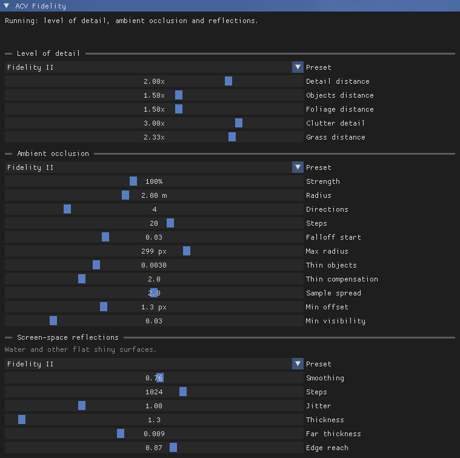

# ACV Fidelity

ReShade add-on that takes three parts of Assassin's Creed Valhalla's graphics past the game's highest
settings: level of detail, ambient occlusion and screen-space reflections. It works inside the game's own
renderer and changes the game's own shaders. The game's art direction is kept.

## What it does

- **Level of detail.** Objects such as buildings and rocks keep their detailed models farther away. Foliage
  and the clutter near you get their own distances too. Grass, flowers and small plants appear much farther
  out instead of ending in flat terrain.
- **Ambient occlusion.** The game's ambient occlusion with more directions and steps. Contact shade under
  objects and in corners is fuller and steadier. Thin things such as grass and poles cast much less false shade.
  The haze they leave over open ground and snow is greatly reduced.
- **Screen-space reflections.** The game's reflections on water and other flat shiny surfaces. More steps
  along each ray reflect thin things such as reeds and posts sharper. Water flickers less. Far water and tall
  things reflect more fully. The game's other reflections are not changed.

Each one has presets: Game, Fidelity I, Fidelity II and Fidelity III. Game is the game's own look. Fidelity II is the
default.

## Requirements

- ReShade 6.8 or newer with add-on support.
- The current version of the game from Steam, Ubisoft Connect or Ubisoft+.

## Installing

1. Install ReShade 6.8 or newer with add-on support.
2. Copy `acvfidelity.addon64` next to `ACValhalla.exe` in the game folder.
3. Start the game and open the ReShade overlay to find the **ACV Fidelity** window.

## Settings

Open the ReShade overlay to find the **ACV Fidelity** window. Every change applies right away. No restart is
needed.



**Level of detail**

| Preset | Detail distance | Objects | Foliage | Clutter | Grass |
|---|---|---|---|---|---|
| Game | 1.0x | 1.0x | 1.0x | 1.0x | 1.0x |
| Fidelity I | 1.5x | 1.25x | 1.25x | 2.0x | 1.67x |
| Fidelity II | 2.0x | 1.5x | 1.5x | 3.0x | 2.33x |
| Fidelity III | 2.5x | 2.0x | 2.0x | 4.0x | 3.0x |

- **Detail distance** is how far away objects keep their detailed models. Up to 2.5x.
- **Objects distance** adds to it for rocks, props, bushes and some trees. Up to 2.0x.
- **Foliage distance** adds to it for the leaves and branches of trees and large plants. Up to 2.0x.
- **Clutter detail** keeps small plants and clutter near you detailed. Up to 4.0x.
- **Grass distance** is how far out grass and small plants appear. Up to 3.0x or about 250 m.
- During loading screens, fast travel and respawns the game's own detail is used. Detail rises back to the
  settings a few seconds after loading ends.

**Ambient occlusion**

| Preset | Directions x steps | Falloff start | Max radius | Thin objects |
|---|---|---|---|---|
| Game | 2 x 5 | 0.50 | 128 px | 0 |
| Fidelity I | 3 x 10 | 0.67 | 213 px | 0.0015 |
| Fidelity II | 4 x 20 | 0.83 | 299 px | 0.0030 |
| Fidelity III | 5 x 30 | 1.00 | 384 px | 0.0045 |

Every Fidelity preset also uses Thin compensation 2, Sample spread 2, Min offset 1.3 px and Min visibility 0.03.

- **Strength** sets how dark the shade gets. It shows most in shade and indoors.
- **Radius** is how far from each pixel occlusion is looked for. Larger fills deep recesses but can add dark
  halos.
- **Directions** and **Steps** set how many samples each pixel takes. More gives fuller and steadier shade.
  GPU time grows in proportion.
- **Falloff start** is the share of the radius where occluders begin to count less. Higher keeps more shade
  from nearby walls and objects.
- **Max radius** limits how wide the search gets on screen up close.
- **Thin objects** lets shade fade behind thin things such as grass and poles. Wider objects such as pots and
  rocks keep their full shade.
- **Thin compensation** makes occluders far behind a surface count less. It greatly reduces the haze grass and
  leaves put on open ground and snow.
- **Sample spread** places more steps close to each pixel where contact shade forms.
- **Min offset** keeps the first step off the pixel itself so surfaces don't shade themselves.
- **Min visibility** limits how dark shade can get. It prevents pitch black spots in tight gaps.

**Screen-space reflections**

| Preset | Smoothing | Steps | Jitter | Thickness | Far thickness | Edge reach |
|---|---|---|---|---|---|---|
| Game | 0.70 | 128 | 1.50 | 2.0 | 0.018 | 0.70 |
| Fidelity I | 0.73 | 512 | 1.25 | 1.6 | 0.013 | 0.78 |
| Fidelity II | 0.76 | 1024 | 1.00 | 1.3 | 0.009 | 0.87 |
| Fidelity III | 0.79 | 4096 | 0.50 | 1.0 | 0.005 | 0.95 |

- **Smoothing** flattens the water before reflecting. Higher reduces flicker but shows less ripple detail.
- **Steps** are the samples along each ray. More gives crisper reflections of thin things. GPU time grows in
  proportion.
- **Jitter** turns banding into fine noise that the game's anti-aliasing smooths. More steps need less of it.
- **Thickness** is how deep behind a surface a ray still counts as a hit. Higher fills holes in reflections.
  More steps need less of it.
- **Far thickness** is the same for rays that travel far. Lower finds reflections on far water.
- **Edge reach** is how close to the top of the screen reflections reach before fading. Higher shows more of
  tall things in the water, such as trees and masts.

All settings are saved in `acvfidelity.ini` next to `ACValhalla.exe`. The file is created on the first start.

## Performance

Measured at 1920x1080 on an RTX 3070 Ti. At 4K the cost is about four times higher. Upscaling such as DLSS
renders at a lower resolution and costs less.

- **Level of detail** costs some frame rate. It depends on how much of the world is in view.
- **Ambient occlusion** took 0.13 ms at Game and about 1.3 ms at Fidelity III. Fidelity I and II
  took about 0.33 ms and 0.75 ms.
- **Screen-space reflections** at Fidelity III took 0.63 ms to 2.14 ms depending on the view.
  Lower presets cost far less.

## Good to know

- It works well with [ACV DLSS](https://www.nexusmods.com/assassinscreedvalhalla/mods/428).
- If dense grass still looks too dark, raise Thin objects or lower the Strength.
- ACV Fidelity writes `acvfidelity.log` next to `ACValhalla.exe`. It starts fresh each time the game starts.
  Attach it together with `acvfidelity.ini` when you report a problem.
- For a detailed log, set `Debug=1` under `[Diagnostics]` in `acvfidelity.ini`.
- ReShade's **Generic Depth** add-on can crash the game on a fast travel or a loading screen. ACV Fidelity
  doesn't need it. Turn it off in the **Add-ons** tab unless an effect you use needs ReShade's depth. If it
  stays on, ACV Fidelity changes one of its settings to stop the crash.

## Building

Visual Studio 2022 and CMake. Clone the dependencies into `deps` first from the repository root:

```
git clone --depth 1 --branch v6.8.0 https://github.com/crosire/reshade.git deps\reshade
```

ReShade passes its own ImGui functions to add-ons. So the ImGui commit has to match the one ReShade pins. For
v6.8.0 it's `3912b3d9a9c1b3f17431aebafd86d2f40ee6e59c`:

```
git clone https://github.com/ocornut/imgui.git deps\imgui
```
```
git -C deps\imgui checkout 3912b3d9a9c1b3f17431aebafd86d2f40ee6e59c
```

Then:

```
cmake -S . -B build -G "Visual Studio 17 2022" -A x64
```
```
cmake --build build --config Release
```

Output: `build\Release\acvfidelity.addon64`. The default `acvfidelity.ini` is built into the add-on from the
repository's copy.

## Acknowledgements

The location and values of the game's LOD factor come from the
[Valhalla LOD Fix](https://www.nexusmods.com/assassinscreedvalhalla/mods/368). I set the 2.5x maximum from my
own stability testing at different values.

Sample spread, Min offset, Min visibility and Thin compensation follow ideas from Intel's
[XeGTAO](https://github.com/GameTechDev/XeGTAO) and BaBa's
[XeGTAO for ReShade](https://github.com/BarbatosAWLS/Reshade-Shaders/blob/main/Shaders/BaBa_XeGTAO.fx).

## Third-party licenses

- [ReShade](https://github.com/crosire/reshade), BSD 3-Clause, copyright Patrick Mours. The add-on is built
  against its add-on API headers.
- [Dear ImGui](https://github.com/ocornut/imgui), MIT, copyright Omar Cornut.

## Development note

AI assistance was used during development. It helped review code, find bugs,
refine the implementation and write documentation. All changes were reviewed
and tested before being included.

This is not a mere "vibe-coded" mod. I spent countless hours and days on it.
I captured and disassembled the game's shaders to find its ambient occlusion,
reflection and lighting passes and the values that control them. I traced
where the game splits its level of detail into categories. I measured
the cost of every setting. And I tested every change in game many times over
before keeping it.

## License

MIT
